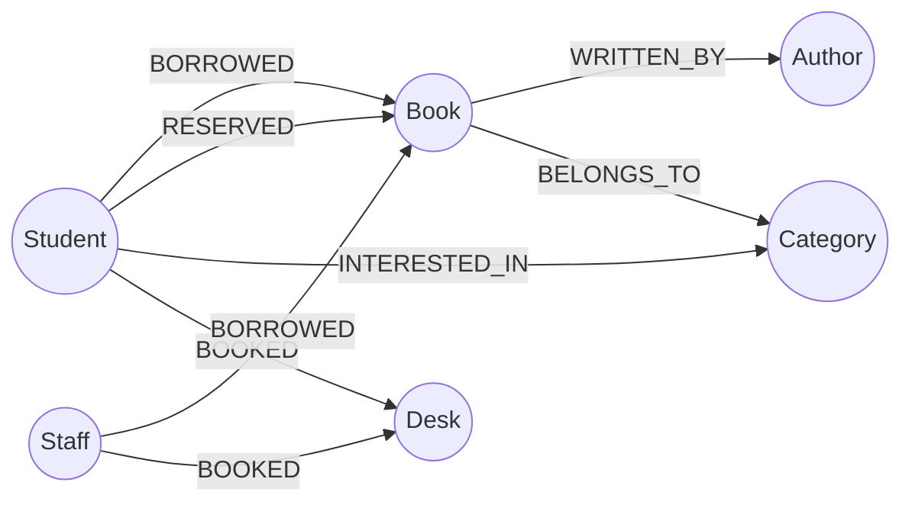

# 📚 Smart Library Management & Booking System

A modern, responsive, and full-featured Smart Library Management and Study Desk Booking System built for colleges and universities.

The platform provides multi-tier role-based access for **Students**, **Faculty/Staff**, and **Library Administrators**, featuring physical and digital book loans, a visual 2D library desk booking module with double-booking prevention, automated overdue fine calculation, and **Neo4j Graph Database** recommendation engine.

---

## 🌟 Key Features

### 1. 🎓 Student Dashboard
- **Secure Registration & Login**: Multi-discipline student accounts with academic topics of interest.
- **Search & Catalog**: Real-time filtering by Title, Author, ISBN, Category, and Availability.
- **Loan & Borrowing System**: 1-click borrow requests with automated 14-day loan duration.
- **Advance Book Reservations**: Reserve unavailable/checked-out books.
- **Loan Renewals**: Extend active loans up to 2 times directly from dashboard.
- **Overdue Fines Tracking**: Automatic daily fine calculation ($1.00/day).
- **Graph AI Recommendations**: Personalized reading recommendations powered by Neo4j graph co-borrowing patterns.

### 2. 🏛️ Faculty / Staff Dashboard
- **Privileged Borrowing Quota**: Extended 30-day loan durations and higher book allowance (10 books).
- **Faculty & Research Suites**: Dedicated booking for Zone D private research pods.
- **Personal Booking Schedule**: Real-time tracking of active loans, returns, and desk passes.
- **Academic Research Recommendations**: Graph traversal matching faculty department and interests.

### 3. ⚡ Admin Control Panel
- **Executive Analytics (Chart.js)**:
  - 7-day borrowing and return volume trends (Line Chart).
  - Catalog category distribution (Doughnut Chart).
  - Real-time desk occupancy across 4 library zones (Bar Chart).
- **Inventory Management**: Add, update, and remove books with ISBN, cover images, shelf locations, and copies.
- **Circulation Control**: Approve/reject loan requests and check in book returns.
- **Desk & Zone Management**: Live floor plan status and maintenance toggles.
- **User Directory**: View registered students and staff, toggle status (Active/Suspended), and adjust roles.
- **Fines Collection**: Mark overdue fines as paid or waive them.
- **Audit Logs**: Real-time audit trail of logins, loans, returns, and reservations.
- **Neo4j Graph Explorer**: Topology metrics of nodes (`Student`, `Staff`, `Book`, `Author`, `Category`, `Desk`) and relationships.

### 4. 🪑 Visual Interactive Desk Reservation System
- **2D Floor Plan Layout**:
  - **Zone A**: Quiet Study Pods (Individual focus booths)
  - **Zone B**: Collaborative Zone (Group tables & mesh Wi-Fi)
  - **Zone C**: Tech & Media Lab (Dual-monitor workstations)
  - **Zone D**: Faculty & Research Suites (Private suites)
- **Interactive Color States**: 🟢 Available, 🟡 Reserved, 🔴 Occupied, 🔵 Selected.
- **Double-Booking & Collision Prevention**: Real-time conflict detection ensuring no two users book overlapping timeslots for the same desk.
- **Flexible Time Slots**: 1 hour, 2 hours, 3 hours, or half-day sessions.
- **Instant Digital Pass**: Personal booking verification and 1-click cancellation.

---

## 🛠️ Technology Stack

| Layer | Technologies |
| :--- | :--- |
| **Frontend** | HTML5, CSS3, JavaScript (ES6+), Bootstrap 5.3, Font Awesome 6, Chart.js 4.4 |
| **Backend** | Python 3.10+, Flask Framework, Flask-Login, Werkzeug |
| **Databases** | **MongoDB** (via PyMongo) &amp; **Neo4j Graph Database** (via official Neo4j Python Driver) |
| **Resilience** | Built-in in-memory fallback store and graph traversal engine for zero-configuration instant out-of-the-box evaluation |

---

## 🗂️ Project Structure

```text
library/
│
├── app.py                      # Flask Application entry point & factory
├── config.py                   # Configuration & environment loader
├── requirements.txt            # Python dependencies
├── seed_data.py                # Database seeding script with sample records
├── .env.example                # Sample environment variables
│
├── models/
│   ├── database.py             # MongoDB client, indexes & activity logging
│   ├── neo4j_models.py         # Neo4j Graph Database driver & AI recommendations
│   ├── user.py                 # User model & authentication helpers
│   ├── book.py                 # Book model, search & inventory logic
│   ├── reservation.py          # Book & Desk reservation logic with collision engine
│   └── loan.py                 # Loan tracking, returns, renewals & fines
│
├── routes/
│   ├── auth.py                 # Authentication, register, login, logout
│   ├── student.py              # Student dashboard & personal loans
│   ├── staff.py                # Faculty dashboard & resources
│   ├── admin.py                # Admin control center, analytics & user management
│   ├── books.py                # Catalog search, filter, and CRUD endpoints
│   ├── booking.py              # Visual desk booking & book reservations
│   └── loans.py                # Loan requests, approvals & returns
│
├── templates/
│   ├── base.html               # Master layout with responsive navbar & footer
│   ├── index.html              # University library landing page & hero
│   ├── login.html              # Login page with 1-click demo credential buttons
│   ├── register.html           # Multi-role registration with category interests
│   ├── student_dashboard.html  # Student portal with recommendations
│   ├── staff_dashboard.html    # Faculty portal with research suites
│   ├── admin_dashboard.html    # Admin analytics & control center
│   ├── books.html              # Catalog grid with advanced filters
│   ├── desk_booking.html       # Visual 2D floor plan seating system
│   ├── reservations.html       # Book hold tracking
│   └── loans.html              # Circulation & loan management
│
└── static/
    ├── css/
    │   └── style.css           # Premium university theme (Navy, Royal Blue, Soft Purple)
    └── js/
        └── main.js             # Desk reservation engine, Chart.js & modals
```

---

## 🚀 Installation & Quick Start

### 1. Clone or Open the Repository
```bash
cd "c:\Users\VIJAY KUMAR\OneDrive\Desktop\library"
```

### 2. Activate Virtual Environment
```bash
# On Windows PowerShell:
.\venv\Scripts\Activate.ps1
# Or Command Prompt:
.\venv\Scripts\activate.bat
```

*(If you ever need to recreate the virtual environment: `python -m venv venv` followed by `pip install -r requirements.txt`)*

### 3. Configure Databases (Optional)
The application includes a resilient auto-fallback layer so it **runs immediately out-of-the-box** even if MongoDB or Neo4j are not running locally. When you are ready to connect to live databases:

#### A. MongoDB Configuration:
- **Local MongoDB**: Run your local `mongod` daemon (`mongodb://localhost:27017`).
- **MongoDB Atlas**: Copy your cloud connection string into `.env`:
  ```ini
  MONGO_URI=mongodb+srv://<username>:<password>@cluster0.mongodb.net/smart_library?retryWrites=true&w=majority
  MONGO_DBNAME=smart_library
  ```

#### B. Neo4j Graph Database Configuration:
- **Local Neo4j**: Start Neo4j Desktop or Community Edition (`bolt://localhost:7687`).
- **Neo4j Aura Cloud**: Copy your Aura instance credentials into `.env`:
  ```ini
  NEO4J_URI=neo4j+s://<dbid>.databases.neo4j.io
  NEO4J_USER=neo4j
  NEO4J_PASSWORD=your_password
  ```

### 4. Seed the Database
To populate the database with academic books, study desks, users, loans, and graph edges:
```bash
python seed_data.py
```

### 5. Start the Flask Server
```bash
python app.py
```
Open your browser and navigate to:
👉 **[http://localhost:5000](http://localhost:5000)**

---

## 🔑 Demo Accounts (Pre-configured)

For quick evaluation, pre-configured accounts are available with 1-click auto-fill buttons on the login screen:

| Role | Email | Password | Privileges |
| :--- | :--- | :--- | :--- |
| **Admin** | `admin@library.edu` | `Admin@123` | Full access, user management, inventory CRUD, analytics |
| **Faculty / Staff** | `prof.smith@library.edu` | `Staff@123` | 30-day loans, 10-book quota, Faculty Suites (Zone D) |
| **Student** | `alex@student.edu` | `Student@123` | 14-day loans, 5-book quota, Quiet Pods, AI recommendations |
| **Student** | `sarah@student.edu` | `Student@123` | 14-day loans, co-borrower for graph recommendations |

---

## 📊 Neo4j Graph Schema

The Neo4j database maintains graph nodes and relationships:



### Collaborative Filtering Cypher Query Example:
```cypher
MATCH (u:Student {id: $user_id})-[:BORROWED]->(b:Book)<-[:BORROWED]-(other:Student)-[:BORROWED]->(rec:Book)
WHERE NOT (u)-[:BORROWED]->(rec)
RETURN rec.title, rec.author, count(DISTINCT other) AS score
ORDER BY score DESC LIMIT 6
```

---

## 🛡️ Security Features
- **Password Hashing**: PBKDF2/SHA256 via `werkzeug.security`.
- **Role-Based Access Control**: Route protections ensuring students cannot access admin tools.
- **Server-Side Collision Engine**: Prevents double-booking desks for conflicting date/time slots.
- **Input Sanitization**: Email normalization and parameter validation on all endpoints.
